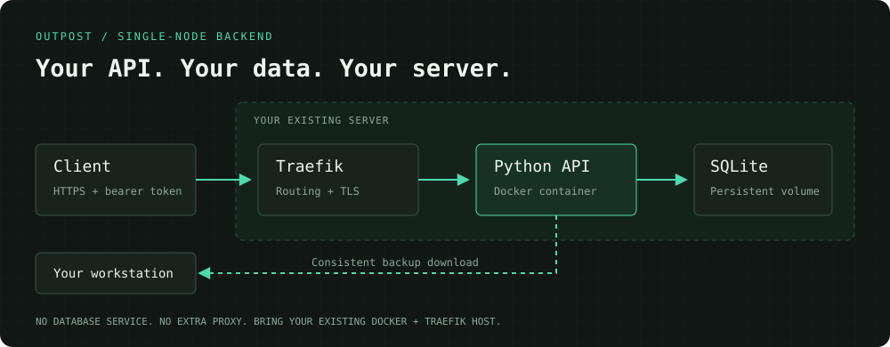

<p align="center">
  
</p>

<h1 align="center">Outpost</h1>

<p align="center">
  <b>A small home for your backend.</b><br>
  A starter repo for a single-server SQLite API. Keep the infrastructure boring.
</p>

<p align="center">
  <a href="#deploy-your-api"></a>
  <a href="docs/operations.md"></a>
</p>

<p align="center">
  <a href="https://github.com/avyayv/outpost/actions/workflows/ci.yml"></a>
  <a href="#the-example-api">API</a> ·
  <a href="#back-up-your-data">Backups</a> ·
  <a href="#make-it-yours">Make it yours</a>
</p>

<p align="center"><sub>macOS · Linux · Python · SQLite · Docker Compose · Traefik</sub></p>

<p align="center">
  
</p>

Not every app needs a backend platform. Sometimes you need a few endpoints, a database file, and a way to deploy without piecing the same setup together again.

Outpost is a **starter repo**, not a hosted service. It ships a token-protected notes API, persistent SQLite storage, and a small CLI for SSH deployment, status, logs, backup, and restore. Python's standard library handles the API; Docker Compose handles the service; your existing Traefik handles HTTPS.

**Built for a single server with modest traffic.** No auth platform, public-client security model, or automatic backup schedule is included. Keep the shared token in trusted clients or server-side code—not a public app bundle.

## Deploy your API

**Bring an existing server, not a blank VPS.** On the server, you need Docker Compose v2 and Traefik configured with the `traefik-network` Docker network, `websecure` entrypoint, and `letsencrypt` certificate resolver. On your workstation, you need Python 3, Docker with Compose v2, and working non-interactive SSH access. The SSH user must be able to create `/srv/outpost` and run Docker. See the [setup requirements](docs/operations.md#requirements).

Install the CLI on your **workstation** (macOS or Linux):

```sh
curl -fsSL https://raw.githubusercontent.com/avyayv/outpost/main/install.sh | sh
```

The installer puts the command in `~/.local/bin/outpost` and its runtime files in `~/.local/share/outpost`. It doesn't need `sudo`. If the installer says `outpost` isn't on your `PATH`, follow its printed shell-profile instruction and open a new terminal.

Create your app in a **new, empty directory**. `init` asks for your domain, SSH host, and app name; or pass them as flags for scripts:

```sh
mkdir my-api && cd my-api
outpost init
# API domain: api.example.com
# SSH host [hetzner]: hetzner
# App name [myapp]: myapp
```

That generates the API starter files and a private token right here in `my-api`. Prefer non-interactive setup? `outpost init --domain api.example.com --host user@your-server --name myapp`. Initialization only writes local files; **it does not touch the server**.

Point the domain's DNS A/AAAA record at the server. Make sure ports 80 and 443 are reachable for HTTPS certificate issuance. Then deploy:

```sh
outpost deploy
outpost status
```

Outpost uploads the generated app into `/srv/outpost/myapp`, builds its container on the server, and waits for a `/healthz` check inside the container. That check doesn't test DNS, Traefik routing, or your HTTPS certificate. It doesn't install Docker, configure Traefik, change your firewall, or set DNS. Verify HTTPS separately:

```sh
curl -i https://api.example.com/healthz
# Expected: HTTP 200 and {"ok": true}
```

## The example API

Write a note, read it back, delete it. All data routes require the bearer token generated by `init`.

```sh
TOKEN="$(tr -d '\n' < secrets/api_token)"

curl -X PUT https://api.example.com/api/notes/hello \
  -H "Authorization: Bearer $TOKEN" \
  -H 'Content-Type: application/json' \
  --data '{"text":"Hello from my own server."}'

curl https://api.example.com/api/notes \
  -H "Authorization: Bearer $TOKEN"

curl -X DELETE https://api.example.com/api/notes/hello \
  -H "Authorization: Bearer $TOKEN"
```

| Endpoint | What it does |
| --- | --- |
| `GET /healthz` | Public service/DB availability check; returns no records |
| `GET /api/notes?limit=100&offset=0` | List notes, with pagination |
| `PUT /api/notes/{id}` | Create or replace a note with `{"text":"..."}` |
| `DELETE /api/notes/{id}` | Delete a note; missing IDs return 404 |

The database is a file in a **persistent Docker volume**. Rebuilding the API doesn't delete it; deleting the volume does. `--name myapp` sets the Compose project to `outpost-myapp` and its data volume to `outpost-myapp_data`. Use a separate checkout and a different name/domain for each app. See [API limits and storage details](docs/operations.md#example-api).

## Deploy changes

Edit the app, test it, deploy again:

```sh
python3 -m unittest discover -s tests -v
outpost deploy
outpost status
outpost logs
```

Deploys use the code in your local checkout. Commit a known-good version before deploying. There's no automatic rollback, and changing the app's Compose project name changes which volume it uses.

## Back up your data

```sh
outpost backup ./backups/2026-01-01.sqlite3
outpost restore ./backups/2026-01-01.sqlite3 --yes
```

`backup` downloads a consistent SQLite snapshot to your workstation while the API keeps running. It refuses to overwrite an existing backup and doesn't leave partial files behind on failure.

`restore` validates the backup, downloads a pre-restore snapshot, stops the API, replaces its database contents, and restarts it. **Restore causes downtime and replaces current records.** Test it on disposable data first.

Backups aren't scheduled for you. Keep encrypted copies off the server, monitor the schedule you choose, and practice recovery. The [operations guide](docs/operations.md#deploy-and-operate) includes a cron example and recovery checklist.

## Ask Pi to build an endpoint

New apps include `POST /_outpost/changes` by default. Send a request with the separate **change token**, and a background Pi worker on your computer implements it in a Git worktree, runs tests, and commits a branch for review. It never automatically merges or deploys.

Install [Pi](https://pi.dev), configure its model-provider login/API key locally, and verify `pi --print "Say ready"` succeeds before starting the worker. No model key is sent to Outpost.

```sh
# Commit your initialized app into Git and configure Pi locally first.
outpost worker start --allow-local-execution

CHANGE_TOKEN="$(tr -d '\n' < secrets/change_token)"
curl https://api.example.com/_outpost/changes \
  -H "Authorization: Bearer $CHANGE_TOKEN" \
  -H 'Content-Type: application/json' \
  --data '{"request":"Add a tasks table and GET /api/tasks with migration and tests","idempotencyKey":"tasks-v1"}'
```

The endpoint queues work even while your computer is offline. Local execution is opt-in: **Pi runs with your user's permissions; a Git worktree is not a sandbox.** Keep this management key private. Existing customized apps aren't silently upgraded. See the [full setup, status API, review workflow and security boundaries](docs/agent-changes.md).

## Make it yours

The notes API is the starting point—not a schema you have to keep. Add your own routes and validation in [`api/server.py`](api/server.py), queries and versioned schema migrations in [`api/store.py`](api/store.py), and tests under [`tests/`](tests/).

Use parameterized queries, preserve authentication on every data route, and plan migrations before changing persistent data. The backup validator in [`api/backup.py`](api/backup.py) also needs to match your schema.

## Know the boundaries

- **Trusted clients only by default.** A shared bearer token is not per-user auth. Tokens embedded in public browser/mobile apps can be extracted. There's no CORS allowance or rate limiter.
- **One server, one database.** SQLite serializes writes. This isn't a multi-node backend; don't share the live DB file over NFS.
- **You operate the host.** DNS, HTTPS prerequisites, firewall rules, updates, monitoring, and off-site backups remain your responsibility.
- **No platform migration.** Outpost doesn't move an existing app or its data for you. Start a new service or write and test an explicit migration.

## Development

No third-party Python packages are required.

```sh
python3 -m unittest discover -s tests -v
outpost --help
docker build -t outpost-api .
```

Tests use temporary databases and a loopback HTTP server. They do not connect to your production server. Read the [operations guide](docs/operations.md) for deployment configuration, security, backups, and recovery.
